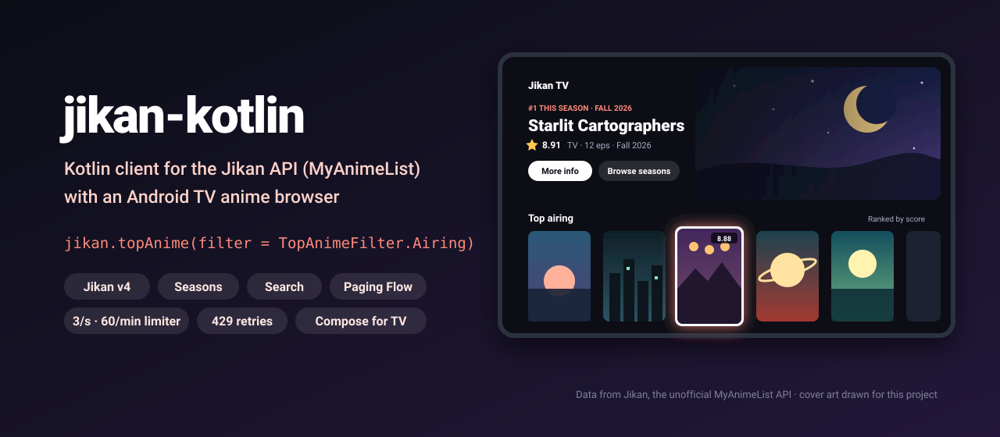

<p align="center">
  
</p>

<p align="center">
  <a href="https://github.com/halilozel1903/jikan-kotlin/actions/workflows/ci.yml"></a>
  <a href="https://jitpack.io/#halilozel1903/jikan-kotlin"></a>
  
  
  
  
  
  <a href="LICENSE"></a>
</p>

**jikan-kotlin** is a Kotlin client for the [Jikan API v4](https://docs.api.jikan.moe), the unofficial MyAnimeList API. It covers anime (with `/full`, characters, staff, episodes, recommendations, pictures and statistics), manga, search with every filter, top lists, seasons, schedules, genres, characters, people and random entries, with typed models that keep Jikan's field names, `suspend` functions, paging as a `Flow`, a rate limiter for Jikan's 3 requests per second and 60 per minute, retries on `429` and an in-memory cache. The core is pure Kotlin/JVM (Ktor and kotlinx.serialization). An optional Compose for TV module adds poster cards with a focus scale, score badges, genre chips and rails, and the sample app is an Android TV anime browser.

```kotlin
val jikan = JikanClient()

val airing = jikan.topAnime(filter = TopAnimeFilter.Airing, limit = 10).data
airing.first().displayTitle                      // the English title, or the default one
airing.first().score                             // Double?, null while unrated

val season = jikan.seasonNow(sfw = true).data    // this season's anime
val summer = jikan.season(2026, Season.Summer).data

val anime = jikan.animeFull(52991)
anime.genres.map { it.name }                     // [Adventure, Drama, Fantasy]
anime.images.large                               // the large WebP cover url
jikan.animeCharacters(52991).first().voiceActor()?.displayName   // the Japanese voice actor, given name first
```

## Features

- **Jikan v4 coverage**: anime by id and `/full`, characters, staff, episodes (paged, and one episode with its synopsis), recommendations, pictures, statistics; manga by id and `/full`, characters, recommendations; search for anime and manga with `q`, `type`, `status`, `rating`, `genres`, `genres_exclude`, `min_score`, `max_score`, `order_by`, `sort`, `sfw` and more; top anime and manga; seasons now, upcoming, any `{year}/{season}` and the season list; schedules by day; genres; characters and people; random anime and manga.
- **Typed models** with Jikan's real nesting: the `data` envelope, `pagination { last_visible_page, has_next_page, current_page, items }`, `images.jpg` and `images.webp`, `titles[]`, `aired` with `prop` and `string`, `score`, `scored_by`, `rank`, `genres[]`, `themes[]`, `demographics[]`, `broadcast` and more. Unknown fields are ignored and missing ones get defaults, so changes on Jikan's side do not break you.
- **Coroutines**: every call is a main-safe `suspend` function that throws a `JikanException` (`NotFound`, `RateLimited`, `Http`, `Network`, `Decoding`).
- **Rate limiting**: a sliding window limiter for Jikan's limits (3 requests per second **and** 60 per minute), shared by every client in the process by default. A `429` answer waits for `Retry-After` (or backs off exponentially), pauses every request on the limiter and retries.
- **Retries** for network errors and `5xx` answers, with exponential backoff.
- **Paging**: `pages { page -> ... }` and ready-made `searchAnimePages`, `topAnimePages`, `seasonNowPages`, `episodePages` as cold `Flow`s that request the next page only when you collect it. `.items()` flattens them to entries.
- **Caching**: an in-memory LRU cache with a TTL (Jikan itself caches MyAnimeList for 24 hours), pluggable through `JikanCache`, and identical requests running at the same time share one network call. `randomAnime()` is never cached.
- **Display helpers**: `displayTitle`, `seasonLabel` (`"Fall 2026"`), `allGenres`, `"Family, Given"` names as `"Given Family"`, `JikanFormat.score`, `compactCount` (`41.3K`) and `summary` (`"TV · 28 eps · Fall 2023 · Madhouse"`).
- **Pluggable HTTP**: Ktor with the CIO engine by default; pass OkHttp, Android, Java or a `MockEngine`, a ready `HttpClient`, or replace HTTP with your own `JikanTransport`.
- **Test fixtures**: `FixtureTransport` serves JSON files by url, for your own unit tests.
- **Compose for TV helpers** (optional module): `PosterCard` and `AnimePosterCard` with a focus scale, glow and border, `ScoreBadge`, `GenreChips`, `RailTitle`, `PosterRail` and `AnimeRail`.
- **Explicit API**, unit tested with Ktor's `MockEngine` against hand-written fixtures in Jikan's JSON format.

### API coverage

| Jikan endpoint | Function | Returns |
| --- | --- | --- |
| `GET /anime/{id}` | `anime(id)` | `Anime` |
| `GET /anime/{id}/full` | `animeFull(id)` | `Anime` with relations, themes, external and streaming links |
| `GET /anime/{id}/characters` | `animeCharacters(id)` | `List<AnimeCharacter>` |
| `GET /anime/{id}/staff` | `animeStaff(id)` | `List<StaffMember>` |
| `GET /anime/{id}/episodes?page=` | `animeEpisodes(id, page)`, `episodePages(id)` | `JikanPage<Episode>`, `Flow` |
| `GET /anime/{id}/episodes/{episode}` | `animeEpisode(id, episode)` | `EpisodeDetail` |
| `GET /anime/{id}/recommendations` | `animeRecommendations(id)` | `List<Recommendation>` |
| `GET /anime/{id}/pictures` | `animePictures(id)` | `List<Picture>` |
| `GET /anime/{id}/statistics` | `animeStatistics(id)` | `AnimeStatistics` |
| `GET /anime?q=&type=&status=&rating=&genres=&order_by=&sort=&sfw=` | `searchAnime(AnimeSearchQuery(...))`, `searchAnime(text)`, `searchAnimePages(query)` | `JikanPage<Anime>`, `Flow` |
| `GET /top/anime` | `topAnime(filter, type, rating, sfw, page, limit)`, `topAnimePages(...)` | `JikanPage<Anime>`, `Flow` |
| `GET /random/anime` | `randomAnime()` | `Anime` |
| `GET /seasons/now` | `seasonNow(type, sfw, continuing, page, limit)`, `seasonNowPages(...)` | `JikanPage<Anime>`, `Flow` |
| `GET /seasons/upcoming` | `seasonUpcoming(type, sfw, page, limit)` | `JikanPage<Anime>` |
| `GET /seasons/{year}/{season}` | `season(year, Season.Summer, ...)` | `JikanPage<Anime>` |
| `GET /seasons` | `seasonList()` | `List<SeasonArchive>` |
| `GET /schedules?filter={day}` | `schedules(ScheduleDay.Friday, sfw, kids, page, limit)` | `JikanPage<Anime>` |
| `GET /manga/{id}` | `manga(id)` | `Manga` |
| `GET /manga/{id}/full` | `mangaFull(id)` | `Manga` with relations and external links |
| `GET /manga/{id}/characters` | `mangaCharacters(id)` | `List<MangaCharacter>` |
| `GET /manga/{id}/recommendations` | `mangaRecommendations(id)` | `List<Recommendation>` |
| `GET /manga?q=&type=&status=&genres=&order_by=&sort=&sfw=` | `searchManga(MangaSearchQuery(...))`, `searchMangaPages(query)` | `JikanPage<Manga>`, `Flow` |
| `GET /top/manga` | `topManga(filter, type, page, limit)` | `JikanPage<Manga>` |
| `GET /random/manga` | `randomManga()` | `Manga` |
| `GET /genres/anime`, `GET /genres/manga` | `animeGenres(filter)`, `mangaGenres(filter)` | `List<Genre>` |
| `GET /characters/{id}` | `character(id)` | `Character` |
| `GET /characters/{id}/full` | `characterFull(id)` | `Character` with anime, manga and voices |
| `GET /characters?q=` | `searchCharacters(text, page, limit)` | `JikanPage<Character>` |
| `GET /people/{id}` | `person(id)` | `Person` |
| `GET /people?q=` | `searchPeople(text, page, limit)` | `JikanPage<Person>` |
| Any path | `get(path, serializer, parameters)` | your model |

## Installation

Add JitPack to `settings.gradle.kts`:

```kotlin
dependencyResolutionManagement {
    repositories {
        google()
        mavenCentral()
        maven("https://jitpack.io")
    }
}
```

Then the dependency:

```kotlin
dependencies {
    implementation("com.github.halilozel1903.jikan-kotlin:jikan:1.0.0")

    // Optional: Compose for TV helpers (poster cards, score badges, genre chips, rails).
    implementation("com.github.halilozel1903.jikan-kotlin:jikan-tv:1.0.0")

    // Optional: use OkHttp instead of Ktor's CIO engine.
    implementation("io.ktor:ktor-client-okhttp:3.6.0")
}
```

> The build is also set up for Maven Central (`io.github.halilozel1903:jikan`) via the vanniktech publish plugin.

`jikan` is a plain Kotlin/JVM library (JDK 17+), so it also works in server and desktop projects. The date helpers (`aired.fromDate`, `Episode.airedDate`) use `java.time`; on Android below API 26 enable [core library desugaring](https://developer.android.com/studio/write/java8-support#library-desugaring) or read the raw strings.

## Usage

**Create a client**

```kotlin
val jikan = JikanClient {
    engine = OkHttp.create()                    // default: CIO
    cache = MemoryCache(maxEntries = 500, ttl = 6.hours)   // null turns caching off
    rateLimiter = JikanRateLimiter.shared       // the default; null for a self-hosted Jikan
    baseUrl = JikanClient.DEFAULT_BASE_URL      // or your own Jikan instance
    userAgent = "my-anime-app/1.0 (+https://example.com)"
    retries = 2                                 // network errors and 5xx
    rateLimitRetries = 3                        // 429 answers
}
// ...
jikan.close()
```

Create one client and share it; it is safe to use from many coroutines. All clients share `JikanRateLimiter.shared` by default, because Jikan counts requests per IP address.

**Anime**

```kotlin
val anime = jikan.animeFull(52991)
anime.title                                     // the default (romanized) title
anime.titles.ofType("Japanese")                 // from titles[]
anime.aired.string                              // MyAnimeList's text, such as "Sep 29, 2023 to Mar 22, 2024"
anime.aired.fromDate                            // LocalDate
anime.seasonLabel                               // "Fall 2023"
anime.score to anime.scoredBy                   // the score and how many users scored it
anime.rank                                      // Int?, null when unranked
anime.studios.map { it.name }
anime.theme?.openings

JikanFormat.summary(anime)                      // "TV · 28 eps · Fall 2023 · <studio>"

val episodes = jikan.animeEpisodes(52991).data
val first = jikan.animeEpisode(52991, 1).synopsis
val stats = jikan.animeStatistics(52991).scores.maxBy { it.votes }
val recommended = jikan.animeRecommendations(52991).map { it.entry.title }
```

**Search**

```kotlin
val page = jikan.searchAnime(
    AnimeSearchQuery(
        query = "space",
        type = AnimeType.Tv,
        status = AnimeStatus.Complete,
        rating = AnimeRating.Pg13,
        genres = listOf(24),                    // Sci-Fi; see animeGenres()
        orderBy = AnimeOrderBy.Score,
        sort = SortOrder.Descending,
        sfw = true,
        limit = 25,
    ),
)
page.pagination.items?.total                    // results in total
page.hasNextPage

jikan.searchManga(MangaSearchQuery(query = "harbor", type = MangaType.Manga))
jikan.searchCharacters("Kanemori")
```

**Seasons, schedules and top lists**

```kotlin
jikan.seasonNow(type = AnimeType.Tv, sfw = true)
jikan.seasonUpcoming()
jikan.season(2026, Season.Summer)
jikan.seasonList().first().parsedSeasons        // [Winter] for the newest year
jikan.schedules(ScheduleDay.Friday)
jikan.topAnime(filter = TopAnimeFilter.ByPopularity)
jikan.topManga(type = MangaType.Novel)
jikan.randomAnime()
```

**Paging**

```kotlin
// Requests page 2 only when the first 25 entries have been collected.
val first60 = jikan.searchAnimePages(AnimeSearchQuery(query = "star")).items().take(60).toList()

jikan.episodePages(21).collect { page -> println("${page.page}: ${page.data.size} episodes") }

// Any paged endpoint:
jikan.pages { page -> jikan.schedules(ScheduleDay.Monday, page = page) }.items().toList()
```

Every page waits for the rate limiter, so collecting a long flow stays inside Jikan's limits.

**Errors**

```kotlin
try {
    jikan.anime(1)
} catch (e: JikanException.NotFound) {
    // no entry with that id
} catch (e: JikanException.RateLimited) {
    // still 429 after every retry; e.retryAfterSeconds says how long to wait
} catch (e: JikanException.Network) {
    // offline or timed out
}
```

**Testing your code with fixtures**

```kotlin
val jikan = JikanClient {
    // fixtures/anime/52991.json, fixtures/seasons/now/limit-24_sfw-true.json, ...
    transport = FixtureTransport { path -> javaClass.getResource("/fixtures/$path")?.readText() }
    rateLimiter = null
}
```

Or pass a Ktor `MockEngine` as `engine`, as this library's own tests do.

### Compose for TV helpers

```kotlin
AnimeRail(title = "Top airing", anime = topAiring, onClick = { open(it) }) { anime ->
    AsyncImage(anime.images.large, contentDescription = null, contentScale = ContentScale.Crop, modifier = Modifier.fillMaxSize())
}

AnimePosterCard(anime, onClick = { open(anime) }) { AsyncImage(it.images.large, null, Modifier.fillMaxSize()) }
PosterCard(title = "Any title", subtitle = "12 votes", score = 8.5, onClick = {}) { MyArtwork() }

ScoreBadge(anime.score)                         // ★ 8.91
GenreChips(anime.allGenres)
RailTitle("This season", trailing = "Fall 2026")
```

Cards are 2:3 like MyAnimeList's covers, grow by `JikanTvDefaults.FocusedScale` with a glow and border when focused, and ellipsize long titles.

## Sample app

The `sample` module is an Android TV anime browser: a hero for the current season's best rated show, rails for top airing, this season, upcoming, Fantasy and Sci-Fi, a detail screen with synopsis, score, rank, popularity, members, genres, episodes, characters with their Japanese voice actors, recommendations and theme songs, and a season browser with a grid and a season picker built from `/seasons`. It uses the live API with OkHttp as the Ktor engine and Coil for cover images.

For screenshots it opens a fixed screen from an intent extra (used by `scripts/screenshots.sh`):

```bash
./gradlew :sample:installDebug
adb shell am start -n io.github.halilozel1903.jikan.sample/.MainActivity --es scene detail
```

`scene` is one of `home` (the current season), `detail` (Fullmetal Alchemist: Brotherhood) or `season` (summer 2024). Scenes load live data through the same client, rate limiter and retries as a normal launch, and log `SCENE_READY` once the data and every image on screen have loaded. CI captures them as `tv-home.png`, `tv-detail.png` and `tv-season.png` on an Android TV emulator, and fails instead of capturing when a scene shows an error, does not finish loading, misses the expected text or is blank.

## Be nice to Jikan

Jikan is a free, open source project run by volunteers. Stay inside its [rate limits](https://docs.api.jikan.moe/#section/Information/Rate-Limiting) (this client does that for you), keep the cache on, and do not crawl the whole API. For heavy use, [host your own Jikan instance](https://github.com/jikan-me/jikan-rest) and point `baseUrl` at it.

## Project structure

| Module | What it is |
| --- | --- |
| `jikan` | Pure Kotlin/JVM: `JikanClient`, models, rate limiter, cache, paging, `FixtureTransport`. Published as `jikan` |
| `jikan-tv` | Compose for TV: poster cards with a focus scale, score badges, genre chips and rails. Published as `jikan-tv` |
| `sample` | The Android TV anime browser, with screenshot scenes |

## Tech stack

Kotlin 2.4 · Ktor 3.6 (CIO, OkHttp) · kotlinx.serialization · kotlinx.coroutines · AGP 9.4 with built-in Kotlin · Gradle 9.6 · Jetpack Compose (BOM 2026.09) · Compose for TV (tv-material 1.1) · Coil 3 (sample) · GitHub Actions with an Android TV emulator

## Legal

Data comes from [Jikan](https://jikan.moe), the unofficial MyAnimeList API. This project is not affiliated with or endorsed by Jikan or MyAnimeList. MyAnimeList is a trademark of its owner. Anime titles, synopses and images returned by the API belong to their respective owners. The screenshots show data and cover images loaded from the Jikan API; this repository does not otherwise include anime artwork.

## License

MIT. See [LICENSE](LICENSE).
